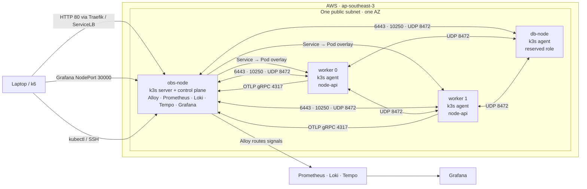

# k3s Observability Lab on AWS

A small, reproducible AWS lab that runs an instrumented Node.js API on k3s and routes **metrics, logs, and traces** through Grafana Alloy into Prometheus, Loki, and Tempo. Grafana is provisioned with its data sources and dashboard from Kubernetes manifests.

This is deliberately a learning environment rather than a production Kubernetes platform. The point is to exercise the whole operational path:

```text
request → Node.js API → OpenTelemetry → Alloy → Prometheus / Loki / Tempo → Grafana
```

## What it demonstrates

- Terraform modules for a VPC, role-specific security groups, EC2 instances, and ECR.
- k3s bootstrap using EC2 user data: one server plus labelled agent nodes.
- An ARM64 (`t4g`) container path from local image build to Amazon ECR to k3s.
- Node.js OpenTelemetry instrumentation for all three signals:
  - traces via OTLP/gRPC;
  - application request counter and duration histogram metrics;
  - Pino logs bridged into the OpenTelemetry Logs SDK.
- Grafana Alloy as the in-cluster OTLP gateway.
- Prometheus remote-write ingestion, Loki log ingestion, and Tempo trace ingestion.
- Grafana provisioning for data sources, Loki↔Tempo trace/log correlation, and a v2 dashboard-as-code resource.
- PromQL-based availability, error ratio, error-budget burn rate, request rate, and latency percentile panels.

## Architecture



### Node roles

| Role | Current instance type | k3s role | Label | Workloads |
|---|---:|---|---|---|
| `obs-node` | `t4g.small` | server/control plane | `role=obs` | Alloy, Prometheus, Loki, Tempo, Grafana |
| `workers-node-1..2` | `t4g.micro` | agent | `role=worker` | `node-api` |
| `db-node` | `t4g.small` | agent | `role=db` | Reserved for the database layer |

The observability components have `nodeSelector: { role: obs }`; the API has `nodeSelector: { role: worker }`.

> **Known topology limitation:** the `obs-node` currently combines the k3s server and the full observability stack. This is intentionally cheap, but it means resource pressure can take out both the control plane and the monitoring stack. The next sensible improvement is a dedicated `role=o11y` agent node and moving Alloy/Prometheus/Loki/Tempo/Grafana there.

## Repository layout

```text
.
├── app/                    # Instrumented Express + Pino API and Dockerfile
├── k8s/                    # Workload, ConfigMap, datasource, and dashboard manifests
├── modules/
│   ├── ec2/                # ARM Ubuntu EC2 module
│   ├── sg/                 # Reusable security-group rule presets
│   └── vpc/                # VPC, subnet, route-table wiring
├── architecture.md         # Detailed infrastructure notes and SG matrix
├── ec2.tf                  # k3s server/agent bootstrap user data
├── security_groups.tf      # Role-specific AWS security groups
└── main.tf                 # Terraform backend, provider, VPC, and ECR
```

## Prerequisites

- Terraform `>= 1.5`
- AWS credentials with VPC, EC2, ECR, and S3-state access
- An existing SSH public key
- `aws`, `kubectl`, `docker`, and `git`
- A region that supports ARM Ubuntu and `t4g` instances; this lab uses `ap-southeast-3`

## Infrastructure setup

### 1. Configure Terraform inputs

Terraform state is configured for the S3 bucket `tf-state-sre-capstone`; it must already exist and be accessible before `terraform init`.

Create `terraform.tfvars` locally (it is intentionally ignored):

```hcl
vpc_cidr      = "192.168.10.0/24"
vpc_name      = "k3s-observability-lab"
vpc_az_count  = 1
vpc_host_bits = 2
key_pair_path = "~/.ssh/id_ed25519.pub"
```

`terraform.tfvars.example` is only a reference. Do not put a real token, private key, AWS credentials, or account ID in Git.

### 2. Provision AWS resources

```bash
terraform init
terraform fmt -recursive
terraform validate
terraform plan
terraform apply
```

Terraform creates the VPC/subnet, ECR repository, security groups, and EC2 instances. The server bootstrap starts k3s with `role=obs`; the agents join it with `role=worker` or `role=db`.

Get the control-plane public IP:

```bash
terraform output -raw bastion_ip
```

Copy the kubeconfig from the server, replace its loopback API endpoint with the public IP or public DNS, then validate the cluster:

```bash
kubectl get nodes -o wide
kubectl get pods -A -o wide
```

Expected node roles:

```text
role=obs      # k3s server/control plane
role=worker   # two API workers
role=db       # reserved database node
```

## Build and deploy the API

### 1. Build and push a multi-architecture image

The cluster is ARM64, so publish an image that includes `linux/arm64`:

```bash
export AWS_REGION=ap-southeast-3
export AWS_ACCOUNT_ID="$(aws sts get-caller-identity --query Account --output text)"
export ECR_REGISTRY="$AWS_ACCOUNT_ID.dkr.ecr.$AWS_REGION.amazonaws.com"

aws ecr get-login-password --region "$AWS_REGION" \
  | docker login --username AWS --password-stdin "$ECR_REGISTRY"

docker buildx build \
  --platform linux/arm64 \
  --tag "$ECR_REGISTRY/node-api:0.0.1" \
  --push \
  ./app
```

Create or refresh the ECR pull secret in the cluster. ECR authorization tokens expire, so regenerate it when image pulls fail with an expired-token error:

```bash
kubectl create secret docker-registry ecr-cred \
  --docker-server="$ECR_REGISTRY" \
  --docker-username=AWS \
  --docker-password="$(aws ecr get-login-password --region "$AWS_REGION")" \
  --dry-run=client -o yaml | kubectl apply -f -
```

### 2. Set the image reference

Edit `k8s/node-api.yaml` and replace:

```yaml
image: <ACCOUNT_ID>.dkr.ecr.<REGION>.amazonaws.com/node-api:<TAG>
```

with the image you pushed. Apply the API configuration and workload:

```bash
kubectl apply -f k8s/api-configmap.yaml
kubectl apply -f k8s/node-api.yaml
kubectl get deploy,po,svc,ingress -o wide
```

The Ingress host is `node-api.local`. From a client that can reach a node’s port 80, send the Host header:

```bash
curl -i -H 'Host: node-api.local' http://<NODE_PUBLIC_IP>/
curl -i -H 'Host: node-api.local' http://<NODE_PUBLIC_IP>/slow
curl -i -H 'Host: node-api.local' http://<NODE_PUBLIC_IP>/error
```

`/slow` waits about two seconds; `/error` returns HTTP 500. They exist to generate recognizable latency and error telemetry.

## Deploy the observability stack

Apply ConfigMaps before workloads that mount them:

```bash
kubectl apply -f k8s/alloy-configmap.yaml
kubectl apply -f k8s/prom-configmap.yaml
kubectl apply -f k8s/loki-configmap.yaml
kubectl apply -f k8s/tempo-configmap.yaml
kubectl apply -f k8s/grafana-datasources.yaml
kubectl apply -f k8s/grafana-provider.yaml
kubectl apply -f k8s/grafana-v2-dashboard.yaml

kubectl apply -f k8s/alloy.yaml
kubectl apply -f k8s/prometheus.yaml
kubectl apply -f k8s/loki.yaml
kubectl apply -f k8s/tempo.yaml
kubectl apply -f k8s/grafana.yaml

kubectl get pods -o wide
```

Grafana is exposed with NodePort `30000`:

```text
http://<OBS_NODE_PUBLIC_IP>:30000
```

The project provisions three Grafana datasources:

| Datasource | Cluster URL | Purpose |
|---|---|---|
| Prometheus | `http://prom:9090` | Metrics, SLI, SLO and latency queries |
| Loki | `http://loki:3100` | Structured application logs |
| Tempo | `http://tempo:3200` | Distributed traces |

It also provisions the exported Grafana v2 dashboard from `k8s/grafana-v2-dashboard.yaml`.

## Telemetry pipeline

```text
node-api
  ├── traces ─┐
  ├── metrics ├── OTLP/gRPC :4317 → Alloy → Tempo / Prometheus / Loki
  └── logs   ─┘

Grafana
  ├── Prometheus: rates, errors, histogram quantiles
  ├── Loki: Pino JSON logs and trace-id lookup
  └── Tempo: trace waterfall and trace-to-logs links
```

The API is started with its instrumentation module preloaded:

```dockerfile
CMD ["node", "--require", "./instrumentation.js", "index.js"]
```

That preload order matters: Pino must be instrumented before `pino-http` is imported. The Logs SDK and `PinoInstrumentation` bridge Pino records to OTLP while preserving JSON logs on stdout.

## Verification checklist

Generate some normal, slow, and failing traffic first:

```bash
for path in / /slow /error; do
  curl -sS -o /dev/null -H 'Host: node-api.local' \
    -w "%{http_code} $path\n" \
    "http://<NODE_PUBLIC_IP>$path"
done
```

Then verify each boundary instead of assuming an open Grafana page proves ingestion:

```bash
# Kubernetes placement and health
kubectl get pods -o wide
kubectl get pods -l app=node-api

# API logs should include Pino JSON, trace context, slow/error messages
kubectl logs deploy/node-api --tail=100

# Alloy receives and exports signals
kubectl logs deploy/alloy --tail=100

# Kubernetes resource metrics; requires k3s metrics-server to scrape kubelets
kubectl top nodes
kubectl top pods
```

In Grafana:

1. **Prometheus** — query `app_http_server_requests_total` and `app_http_server_duration_seconds_bucket`.
2. **Loki** — start with `{service_name="node-api"} | json`; find `Slow response` or `Intentional error`.
3. **Tempo** — search `service.name = node-api` and open a trace.
4. From a Loki event with a `traceid`, use **View Trace**; from Tempo, use **Trace to logs**.
5. Open the provisioned dashboard for availability, error ratio, burn rate, request rate, and p90/p95/p99 latency.

Useful PromQL examples:

```promql
# 5-minute availability: 1 - 5xx ratio
1 - (
  sum(rate(app_http_server_requests_total{http_response_status_code=~"5.."}[5m]))
  /
  sum(rate(app_http_server_requests_total[5m]))
)
```

```promql
# p95 latency in seconds
histogram_quantile(
  0.95,
  sum by (le) (rate(app_http_server_duration_seconds_bucket[5m]))
)
```

```promql
# Mean latency in seconds
sum(rate(app_http_server_duration_seconds_sum[5m]))
/
sum(rate(app_http_server_duration_seconds_count[5m]))
```

## Security-group model

The security-group design is role based:

- the control plane accepts operator SSH/API access from the detected caller IP;
- workers and DB node accept kubelet traffic from the obs node;
- k3s/Flannel nodes permit UDP/8472 VXLAN traffic across their role groups;
- workers join the k3s API at TCP/6443;
- Grafana is exposed as NodePort TCP/30000 only to the detected caller IP.

Read [`architecture.md`](architecture.md) for the full current SG matrix and traffic diagram.

A useful distinction while debugging:

```text
Flannel VXLAN (UDP/8472) moves pod-overlay traffic.
metrics-server scrapes node kubelets on node-IP TCP/10250.
```

They are separate network paths. If `kubectl top nodes` has `<unknown>` for only some nodes, check which node runs metrics-server and whether its security group can reach every target node’s TCP/10250.

## Known limitations and intentional trade-offs

- Single AZ, public subnet, and one k3s server; no HA or control-plane failover.
- `obs-node` shares the control plane with the observability stack; separate it before treating the lab as resilient.
- The k3s installer currently fetches the newest release during bootstrap. Pin `INSTALL_K3S_VERSION` to a tested release for fully repeatable rebuilds.
- `user_data` only runs on first boot. Replace an instance when testing changed bootstrap logic:

  ```bash
  terraform apply -replace='module.ec2_obs.aws_instance.ec2[0]'
  ```

- The generated k3s join token appears in Terraform state and instance user data. Fine for a short-lived lab; use SSM Parameter Store or Secrets Manager in a real environment.
- Prometheus, Loki, Tempo, and Grafana use local-path storage. There is no backup, replication, or durable remote storage.
- `prom-data` is declared but is not yet mounted by `k8s/prometheus.yaml`; Prometheus samples are therefore currently ephemeral. Mount it at `/prometheus` before relying on retained metrics.
- Grafana’s dashboard ConfigMap embeds an exported JSON document. It works, but extracting the dashboard to a standalone file and generating the ConfigMap with Kustomize would make diffs much easier to review.
- The AWS region, backend bucket, AMI selection, and node sizes are currently project-specific rather than parameterized.

## Teardown

This project creates billable AWS resources. When finished:

```bash
terraform destroy
```

Then verify in AWS that no EC2 instances, EBS volumes, ECR images, security groups, or other resources from the lab were left behind.

## Next improvements

1. Add a dedicated `role=o11y` agent node and move the observability stack off the control plane.
2. Mount `prom-data` into Prometheus and set retention explicitly.
3. Pin k3s to a tested version rather than resolving GitHub `latest` at boot.
4. Move the dashboard JSON out of the ConfigMap literal; generate the ConfigMap from source.
5. Add health/readiness probes and resource requests/limits to all workloads.
6. Add recording rules and multi-window burn-rate alerts after the SLI has enough traffic.
7. Add the PostgreSQL + pgBouncer workload on `role=db`, plus a traceable API database call.

## License

No license has been declared yet.
