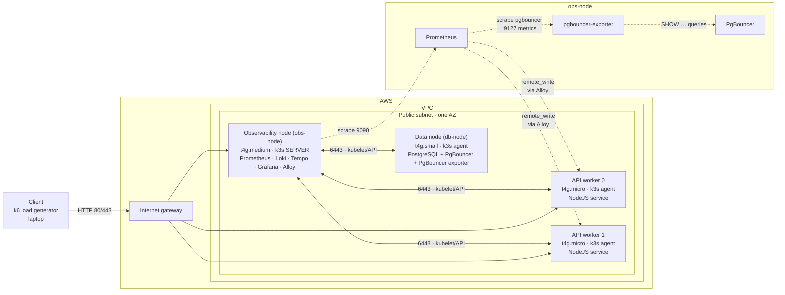

# SRE Capstone: k3s Observability Lab on AWS

A load-tested, three-node microservice lab on k3s with a full LGTM-style
(metrics / logs / traces) stack — provisioned with Terraform, instrumented with
OpenTelemetry, and monitored through Prometheus + Grafana + Loki + Tempo.

Everything this README describes was applied to a live cluster using
`deploy.sh`.

## What this demonstrates

- Terraform root-module composition and reusable VPC / security-group modules.
- Security-group rules using reusable named ingress presets plus custom rules.
- EC2 bootstrap using cloud-init `user_data` and a shared k3s token.
- Worker placement with `count.index % length(public_subnet_ids)`.
- A Node.js API (`app/`) instrumented with the OpenTelemetry Node SDK, sending
  metrics, traces, and logs to Grafana Alloy.
- Prometheus `remote_write` receiver (Prometheus scrapes Alloy's metrics
  endpoint) plus an explicit PgBouncer scrape job.
- PgBouncer as a connection pooler between the API and PostgreSQL, with the
  official Prometheus community exporter.
- Pre-provisioned Grafana datasources (Prometheus, Loki, Tempo) broke out of
  the Grafana image via `grafana-datasources.yaml`.

## Architecture



## Requirements

- Terraform
- AWS CLI credentials with EC2/VPC permissions
- An existing SSH public key
- `kubectl` for cluster validation
- AWS region with an Ubuntu ARM64 AMI and an ARM-compatible instance type,
  such as `t4g.micro`

## Configuration

Create an untracked `terraform.tfvars` from your local values. Use the example
file as reference:

```hcl
vpc_cidr      = "192.168.10.0/24"
vpc_az_count  = 2
vpc_host_bits = 1
vpc_name      = "sre-vpc"
key_pair_path = "~/.ssh/id_ed25519.pub"
```

`key_pair_path` is your SSH public key; it appears (rather than the private key)
in the EC2 module.

## Deploy

Fill in your AWS profile, region, and app image references (`deploy.sh` is a
skeleton), then:

```bash
terraform init
terraform fmt -recursive
terraform validate
terraform plan
```

To bring up the cluster, build/push the app image, and apply the manifests:

```bash
./deploy.sh
```

The script uses the top-level `node-api.yaml` image
(`<ACCOUNT_ID>.dkr.ecr.<REGION>.amazonaws.com/node-api:<TAG>`), so update that
manifest with your account, region, and tag before running it.

Get the control-node address:

```bash
terraform output -raw bastion_ip
terraform output -raw bastion_dns
```

SSH through the control node when worker security groups permit SSH only from
the control-node security group:

```bash
export CONTROL_IP=$(terraform output -raw bastion_ip)
ssh -i <PRIVATE_KEY_PATH> ubuntu@$CONTROL_IP
```

## Validate

Confirm that all nodes joined:

```bash
kubectl get nodes -o wide
kubectl get pods -A -o wide
```

### The stack, port by port

| Component | Service DNS | Reachable |
|---|---|---|
| Node API | `node-api` : 80 | via Ingress `node-api.local` |
| PgBouncer | `pgbouncer` : 6432 | db node |
| PostgreSQL | `pg` : 5432 | db node, direct |
| PgBouncer exporter | `pgbouncer-exporter` : 9127 `/metrics` | db node |
| Prometheus | `prom` : 9090 | obs node |
| Loki | `loki` : 3100 | obs node |
| Tempo | `tempo` : 3200 | obs node |
| Grafana | `grafana` : 30000 NodePort | obs node |

### Test the PgBouncer exporter

Port-forward and hit the metrics endpoint:

```bash
kubectl port-forward service/pgbouncer-exporter 9127:9127 &
curl -s localhost:9127/metrics | grep '^pgbouncer_'
```

Expected families include `pgbouncer_client_connections` (labels `database`,
`user`, `application_name`, `state`), `pgbouncer_pools_client_waiting_connections`,
and `pgbouncer_stats_queries_pooled_total`.

### Validate the full path

The API is exposed via Ingress `node-api.local` on the control node's public
IP. Send a request with the matching `Host` header:

```bash
curl -i -H 'Host: node-api.local' http://"$EC2_IP"
```

Do not use `curl localhost` to test ServiceLB. k3s ServiceLB installs DNAT
rules. Loopback traffic does not take the same PREROUTING path as traffic
addressed to the node IP, and `ss -tlnp` will not show a userspace listener on
port 80.

## Observability

### Metrics

Prometheus (`prom`) is the single source of truth for metrics:

- It scrapes Alloy's own metrics endpoint (`alloy:8888`) and the PgBouncer
  exporter (`pgbouncer-exporter:9127`).
- The API's OTel metrics reach Prometheus over Alloy's `remote_write` receiver.

From Grafana, the Prometheus datasource (`prom:9090`) is the default.

### Logs

The API ships pino logs over OTLP to Alloy, which forwards them to Loki
(`loki:3100`). Query with:

```logql
{job="node-api"}
```

### Traces

The API ships OTLP traces to Alloy, which forwards to Tempo (`tempo:4317`),
with Grafana's Tempo datasource configured for trace→log correlation.

### PgBouncer metrics caveat

`pgbouncer_client_connections` is a **current-value gauge**. To aggregate by
client state, do NOT apply a rate — sum it:

```promql
sum by (state)(
  pgbouncer_client_connections{database="appdb"}
)
```

For pooled-query throughput (a true counter), a rate is correct:

```promql
sum by (database)(
  rate(pgbouncer_stats_queries_pooled_total{database="appdb"}[5m])
)
```

## Security-group design

The security-group module contains named ingress presets, such as `ssh`,
`k8s_api`, `kubelet`, and `flannel_vxlan`. The caller supplies the source CIDR
or source security-group ID.

The control and worker security groups cannot both embed their reverse
references inside module arguments. That creates a Terraform graph cycle. This
repo keeps worker rules that refer to the control SG in the worker module call,
then creates the control-side rules from the worker SG as root-level
`aws_security_group_rule` resources.

Flannel VXLAN uses UDP/8472 beneath Kubernetes traffic. Security groups must
permit that overlay traffic in both directions between nodes. TCP connection
tracking for the application request does not cover a separate UDP VXLAN flow.

## Bootstrap behavior

`user_data` runs on first boot. Editing the script after an EC2 instance
already exists does not rerun it. Replace the instance when testing an amended
bootstrap script:

```bash
terraform apply -replace='aws_instance.ec2_control'
terraform apply -replace='aws_instance.ec2_workers[0]'
```

A shared `k3s_token` allows workers to join the control plane. It is suitable
for this short-lived lab, but it appears in Terraform state and instance user
data. Production infrastructure should source it from SSM Parameter Store or
Secrets Manager.

## Teardown

This project creates billable EC2 and EBS resources. Destroy it after each lab
session:

```bash
terraform destroy
```

Then verify the AWS console has no remaining instances, volumes, elastic IPs,
or security groups created by this project.

## Limits

This is a learning environment, not a production Kubernetes design.

- One AZ and one control-plane node. No control-plane HA.
- Public subnet placement to avoid NAT Gateway cost.
- One shared, plaintext lab token in Terraform state and `user_data` (see
  `modules/ec2/main.tf`).
- The app image is a private ECR image; `deploy.sh` builds multi-arch
  (`linux/amd64,linux/arm64`) and pushes it, with an `ecr-cred` image pull
  secret and `imagePullSecrets` on the API Deployment.
- Lab credentials (`postgres`, `pgbouncer`) are plaintext in `k8s/` secrets —
  fine for a throwaway lab, never for anything shared.
- No remote state locking, autoscaling, backups, or automated node
  replacement.
- k3s bundled components rather than a managed Kubernetes service.

A production follow-up would use multiple AZs, private worker subnets, a load
balancer, encrypted secret delivery, remote state with locking, monitoring, and
either an HA k3s topology or EKS.

## Notes

Inspired by the project structure discussion in
[`corymhall/example-terraform-project`](https://github.com/corymhall/example-terraform-project).
The implementation here is intentionally smaller and focused on one k3s lab
cluster.
