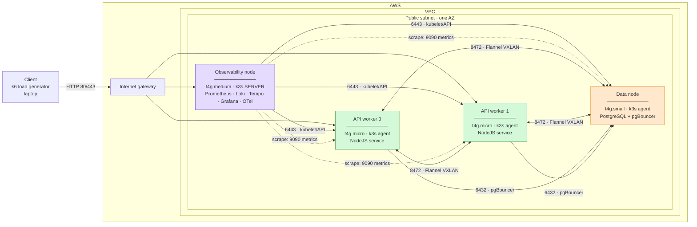

## Architecture:

## Resources setup:
- AWS VPC
  - 1 public subnet, 1 AZ
  - ap-southeast-3 region
- Backend
  - S3 Bucket: tf-state-sre-capstone
- AWS EC2 Node:
  - 1x `obs-node`
    - t4g.medium
    - taint: obs-control
    - SG Ingress:
      - 22 From x IP
      - 6443 (k8s API) from `worker-node` and `db-node`
      - 4317 (OTLP) from `worker-node` and `db-node`
      - 4318 (OTLP) from `worker-node` and `db-node`
      - 3000 (Grafana) From x IP
      - 8472 (Flannel VXLAN) from `self`, `worker-node` and `db-node`
  - 2x `worker-node`
    - t4g.micro
    - SG Ingress:
      - 10250 (kubelet) from `obs-node`
      - 8472 (Flannel VXLAN) from `self`, `worker-node` and `db-node`
      - 3000 (NodeJS API) from `worker-node`
  - 1x `db-node`
    - t4g.small
    - SG Ingress:
      - 10250 (kubelet) from `obs-node`
      - 8472 (Flannel VXLAN) from `self`, `worker-node` and `db-node`
      - 6432 (pgBouncer) from `worker-node`
